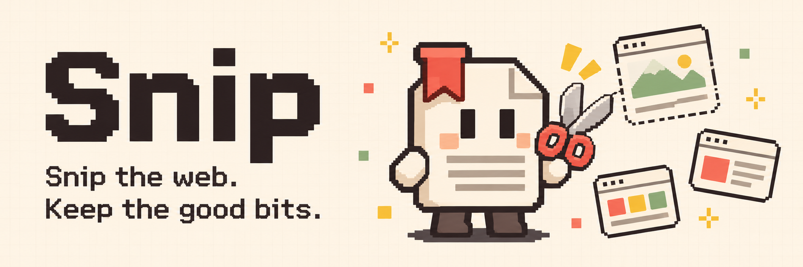
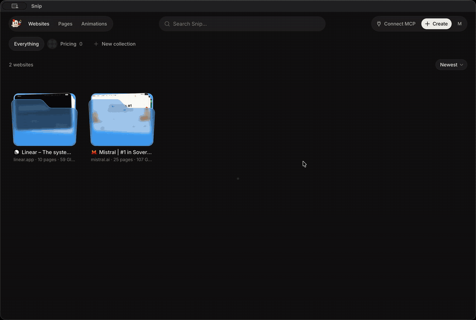
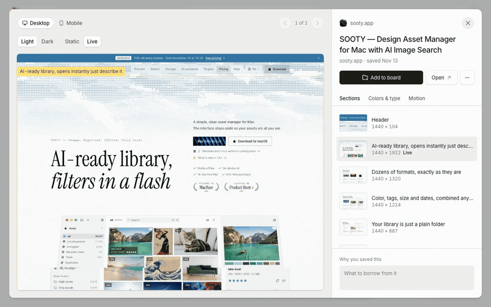
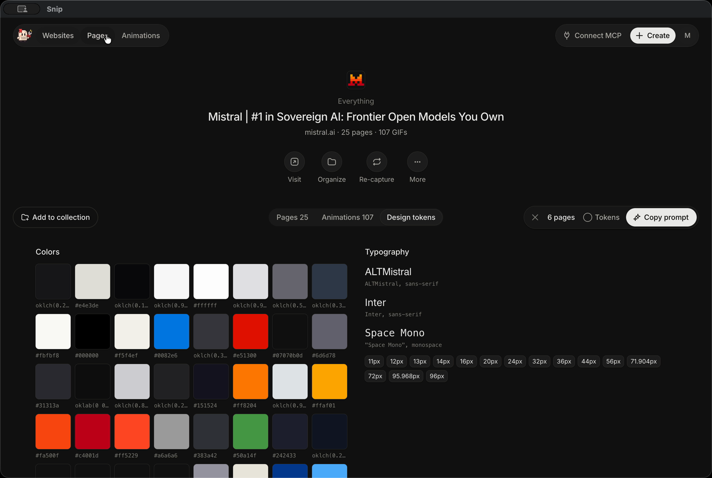
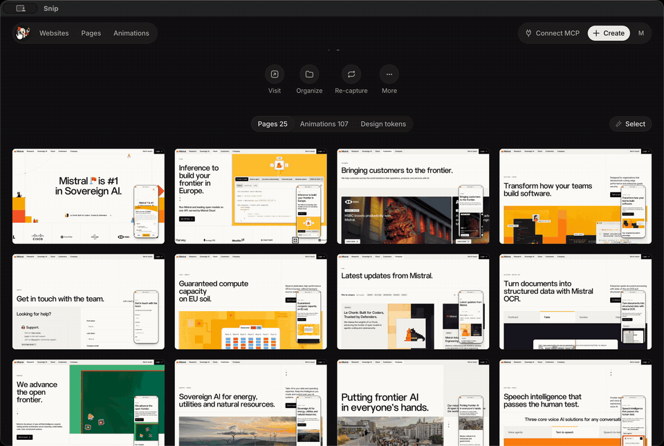
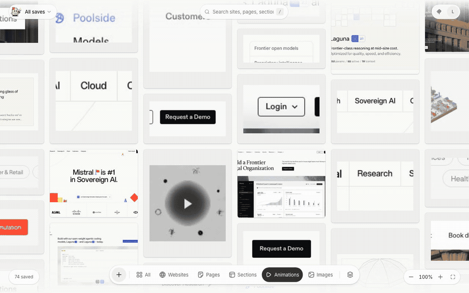
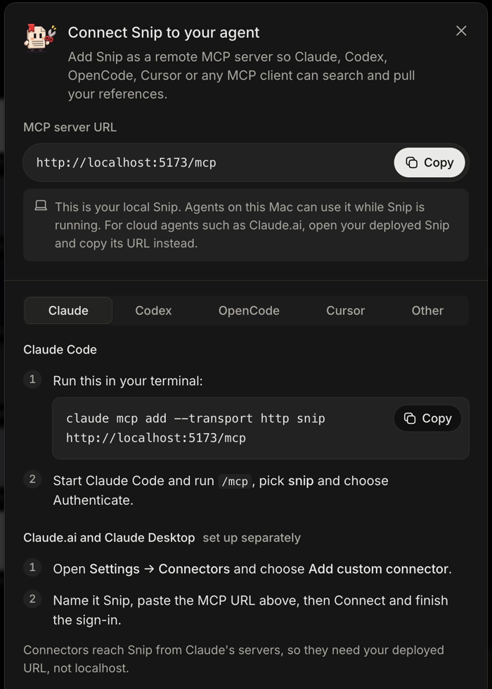

# Snip

A private, Cosmos-style library of website design references. Paste a URL, choose **Static page** or **Crawl site**, and a capture agent on your machine records every page.



Each capture includes:

- Desktop (1440px) and mobile (390px) full-page screenshots
- **Computed styles** per element (only values that differ from browser defaults, plus `::before`/`::after`), keyframes, `:hover` rules and CSS variables
- A **self-contained HTML snapshot**: linked and cross-origin CSS inlined, CSS-in-JS / CSSOM rules materialized, web fonts embedded, scripts stripped
- **Scroll GIFs** per page and **hover GIFs** for elements with hover effects
- Extracted **design tokens**: colors, fonts, type scale, spacing, radii, shadows, transitions

The app is an infinite gallery (Websites / Pages / Animations) with search and sort. Inside it you can:

- Save whole websites or **individual pages** to collections
- Open any page in a **resizable viewer** with a sidebar of **Tokens**, **HTML** and **CSS** tabs
- Use **Select** to pick pages, animations and tokens, then **Copy prompt** to hand them to an agent
- Open **Connect MCP** in the top bar for copy-ready setup for Claude, Codex, OpenCode, Cursor and other clients

A **remote MCP server** lets your agent search, read and add references.

Website: [usesnip.dev](https://usesnip.dev). Latest release: [v0.1.0](https://github.com/MaxChen04/Snip/releases/tag/v0.1.0) (source only; Snip is self-hosted). License: [source-available](#license).

## Tour

**Page viewer.** Drag the sidebar to resize it, switch between Tokens, HTML and CSS, and flip between desktop and mobile captures.



**Design tokens.** Every website gets its colors, type, spacing, radii and shadows extracted.



**Select and Copy prompt.** Pick pages, animations and tokens, then copy a prompt that points your agent at exactly those references over MCP.



**Animations.** Scroll and hover GIFs from every capture, in one feed.



## How it works

```
┌──────────── Cloudflare (free plan) ─────────────┐        ┌──── Your machine ────┐
│ Worker: React gallery + API + /mcp (OAuth)      │◀─poll──│ capture agent        │
│ D1: references, pages, animations, collections  │──job──▶│ (Playwright/Chromium)│
│ R2: screenshots, GIFs, HTML snapshots, styles   │◀upload─│                      │
│ KV: OAuth tokens                                │        └──────────────────────┘
└─────────────────────────────────────────────────┘
```

Capture runs locally because the free plans can't crawl sites: Cloudflare's free Browser Rendering allows 10 browser-minutes a day, and Vercel Hobby functions stop after 5 minutes. Queued references wait until the agent is running.

## Public site (usesnip.dev)

`web/` also builds the public site: the landing page and setup guide as static files, with GitHub CTAs instead of sign-in and no API behind them. It deploys as its own Worker, `snip-site` (`web/site/`), separate from the app Worker, and binds the custom domains `usesnip.dev` and `www.usesnip.dev` (www redirects to the apex). The build adds per-page titles, descriptions, canonical URLs, Open Graph tags, `og.png`, `robots.txt`, `sitemap.xml` and a 404 page.

```bash
cd web
npm run build:site      # writes dist-site/
npm run deploy:site     # needs `npx wrangler login` on an account that owns the usesnip.dev zone
```

Self-hosted copies don't need any of this; `npm run deploy` is still the only deploy for your own gallery.

## Stack

- `web/`: Vite + React 19 + Tailwind v4, **shadcn** with the **SortUI** registry (`@sortui` theme and components in `src/components/ui`, restyled with tactile surfaces), **Hugeicons**, Hono on Cloudflare Workers, D1, R2, `@cloudflare/workers-oauth-provider`, MCP via `agents/mcp/server` (stateless `createMcpHandler`).
- `capture/`: Node 22+ + Playwright, `gifenc` for GIF encoding.
- `desktop/`: Electron menu-bar app for Apple Silicon Macs (Snip.app, currently 0.2.0).

Add more SortUI components with `cd web && npx shadcn@latest add @sortui/<name>`.

## Local development

```bash
npm install
cp web/.dev.vars.example web/.dev.vars          # DEV_LOGIN skips GitHub login on localhost
npm run db:migrate:local -w web
npm run dev                                       # http://localhost:5173

# second terminal
cp capture/.env.example capture/.env              # SNIP_URL=http://localhost:5173, CAPTURE_TOKEN from .dev.vars
npx playwright install chromium                   # once
npm run capture
```

### Mac app

On **Apple Silicon with macOS 14 or later**, once local development works, build a clickable **Snip.app**. Use native arm64 Node.js 22.18+ or 24.11+; Intel and Rosetta are unsupported.

```bash
npm run app        # builds Snip.app and installs it in /Applications
```

The normal app serves the built gallery and the existing local Worker API with file watching and the inspector disabled. It uses the same `web/.dev.vars` and `web/.wrangler/state` as local development. Configure `capture/.env` with `SNIP_URL=http://localhost:5173` and the same `CAPTURE_TOKEN` as `web/.dev.vars`.

The menu bar shows whether capture is ready, busy, or disconnected. **Quit Snip** and **Stop web app** let capture finish before stopping its local API. **Force quit** explicitly interrupts unfinished work. Closing the window keeps capture available; the hidden gallery is released after two minutes and restores its selection, search and scroll state when reopened. Chromium loads only for an actual capture and closes after two idle minutes. Healthy empty-queue polling backs off to 30 seconds; adding or re-capturing from the app wakes it immediately. References queued elsewhere may wait up to that interval. Failed connections use retry backoff capped at one minute.

Service logs are capped at three 2 MiB files per service (12 MiB total), including backups; duplicate Wrangler debug-file logging is disabled. Electron's disposable HTTP disk cache has a 64 MiB budget. Captured library assets are retained until you delete them; idle cleanup does not delete your library. The hidden or minimized gallery is released after the grace period, unless a dialog has unfinished input. Minimized snapshot viewers unload their document and reload it when restored. Adjust `BROWSER_IDLE_SECONDS` in `capture/.env` for capture browser retention. Set `SNIP_WINDOW_IDLE_SECONDS` when launching Electron to change the window grace period (`0` disables window release).

The app runs this repo in place. Rebuild web assets after web changes (`npm run build -w web`); rebuild the app after moving the repo or changing `desktop/`. It is ad-hoc signed for your own Mac and is not notarized for distribution. `npm run app:dev` uses Vite with hot reload for development (install desktop dependencies first with `npm ci --prefix desktop`). The installer verifies an existing app's identity, stages and verifies the new copy, and restores the old app if replacement fails. For a build without installation: `npm run build --prefix desktop -- --no-install`; `--out DIR` and `--install-dir DIR` support isolated builds and tests.

### Release app and updates

Signed release builds contain their own web app, capture engine, Node.js and Chromium. They check for **published stable releases** at most once every six hours, including after sleep, and expose **Check for updates** in the Snip and menu-bar menus. Downloads begin only when you choose **Download update**. **Restart and update** lets an active capture finish before stopping its API and installing. A downloaded update can also apply on the next normal quit/relaunch. Failed downloads leave the running version intact; the native macOS updater verifies the archive digest, size and signing identity.

Your library and credentials stay outside the app. On first launch, choose an existing Snip project folder or create a new library in Snip's Application Support directory. Stop and drain any separate development server and capture agent before using an existing library; never run them concurrently against the same library. The chosen project folder remains the data location even though release code runs from the app: keep its configuration, `.snip` storage identity record and `web/.wrangler/state`. Imported database, file and OAuth-storage identities stay attached to that library across releases. If its folder moves, **Retry setup** offers to locate it again. Upgrades apply local D1 migrations before serving the app. The latest three successful pre-upgrade database backups are kept under the library's `backups/`; failed-upgrade backups remain for manual recovery. An upgrade failure stops startup and shows the backup location. A bounded private cache restores your reference route and selection after a graceful restart.

**No signed app has been released yet.** The repository is public and v0.1.0 is a source-only release, but there is no Apple Developer signing identity, so build Snip.app yourself with `npm run app`. Local/ad-hoc builds keep in-app updates disabled. The first signed release must be installed manually; later signed releases can update it. Publishing does not happen on a merge. See [the release guide](desktop/RELEASING.md) for signing setup, draft release review and the two-version update acceptance check.

## Deploy to Cloudflare (free plan)

1. **GitHub OAuth app** (github.com → Settings → Developer settings → OAuth Apps → New):
   - Homepage URL: `https://snip.<your-subdomain>.workers.dev`
   - Callback URL: `https://snip.<your-subdomain>.workers.dev/auth/callback`
2. **Create resources** and paste the printed ids into `web/wrangler.jsonc`:
   ```bash
   cd web
   npx wrangler d1 create snip
   npx wrangler kv namespace create OAUTH_KV
   npx wrangler r2 bucket create snip-files
   ```
   Also set `PUBLIC_URL` and `ALLOWED_GITHUB_LOGINS` in `wrangler.jsonc`.
3. **Secrets**:
   ```bash
   npx wrangler secret put GITHUB_CLIENT_ID
   npx wrangler secret put GITHUB_CLIENT_SECRET
   npx wrangler secret put SESSION_SECRET     # openssl rand -hex 32
   npx wrangler secret put CAPTURE_TOKEN      # openssl rand -hex 32
   ```
4. **Migrate and deploy**:
   ```bash
   npm run db:migrate:remote
   npm run deploy
   ```
5. Point `capture/.env` at the deployed URL with the same `CAPTURE_TOKEN`, then `npm run capture`.

**Upgrading an existing hosted installation:** Stop all existing capture agents gracefully and wait for captures, uploads, and in-flight Worker requests to finish. Run `npm run db:migrate:remote -w web` **before deploying the updated Worker**; this includes `0003_capture_attempts.sql` and `0004_page_collections.sql`. Then deploy the Worker and update/restart every capture agent. The Worker rejects older agents before they can claim jobs (HTTP 426). Existing saved assets remain readable.

Packaged release apps apply pending local migrations before starting and back up an existing local D1 database first. For a source-linked desktop app or local development checkout, run `npm run db:migrate:local -w web` before starting the updated app. Migration 0004 adds the page-membership table and two indexes; it does not copy or move saved files. Retired-file cleanup retries on queue activity with backoff; interrupted uploads can retain safety metadata when their final write status is uncertain.

Free-tier headroom: R2 gives 10 GB (roughly 1,500 to 3,000 captured pages, depending on page length and GIFs), D1 5 GB, Workers 100k requests/day.

## Connect your agent (remote MCP)

The MCP endpoint is `https://snip.<your-subdomain>.workers.dev/mcp`. Clients register themselves, send you through GitHub login, and show a consent screen.

```bash
claude mcp add --transport http snip https://snip.<your-subdomain>.workers.dev/mcp
```

Codex (the CLI, IDE extension and Codex desktop app share `~/.codex/config.toml`):

```bash
codex mcp add snip --url https://snip.<your-subdomain>.workers.dev/mcp
codex mcp login snip
```

OpenCode (`~/.config/opencode/opencode.json` or a project `opencode.json`; note the `mcp` key and `type: "remote"`), then `opencode mcp auth snip`:

```json
{ "mcp": { "snip": { "type": "remote", "url": "https://snip.<your-subdomain>.workers.dev/mcp" } } }
```

For Claude.ai or Claude Desktop, add it as a custom connector with the same URL.



The **Connect MCP** button in the app's top bar shows these steps with your own URL filled in. In the local app or Snip.app the URL is `http://localhost:5173/mcp`, which only agents on the same Mac can reach while Snip is running; cloud agents such as Claude.ai need your deployed URL.

| Tool | What it does |
| --- | --- |
| `search_references` | Search by text, collection or domain; returns summaries with ids |
| `get_reference` | One reference in bounded parts: `overview`, `pages`, `animations`, `tokens` (optionally one `token_group`, paginated). `full` is the legacy everything-at-once read |
| `get_page` | One page: signed screenshot URLs with coverage, a token summary, an inline viewport screenshot and optional HTML in chunks |
| `get_page_styles` | Valid, bounded computed styles: summary, filtered elements, keyframes, hover rules, font faces, CSS variables |
| `get_animation` | One animation: a manifest (timing provenance, sampled frames, the element's observed styles) plus a contact sheet, a single frame or the GIF |
| `search_pages` | Pages across all references; with a collection, its saved pages and the pages of its websites |
| `search_animations` | Scroll and hover animations across all references |
| `get_capture_status` | Job state, last progress and when the capture worker last checked in, with a suggested poll delay |
| `list_collections` | Collections with website and page counts |
| `add_reference` | Queue a URL (`single` or `crawl`) for capture |
| `create_collection` | New collection |
| `set_collection_membership` | Add or remove a whole website from a collection |
| `set_page_collection_membership` | Add or remove individual pages from a collection |

Every result carries the same JSON as text and as `structuredContent`. Bounded lists are capped by item count and bytes and say what they left out and how to continue; the legacy full reference read can be larger. Many models only see the first frame of a GIF, so new captures also store sampled frames and a contact sheet per animation (animations captured earlier only have the GIF until you recapture).

File URLs returned by the MCP are signed and expire after 24 hours.

`get_page(include_styles: true)` now returns guidance to `get_page_styles` instead of a truncated JSON fragment. Update client prompts to use the new tool for styles. Existing `get_reference` calls without `part` still return the full legacy result, and old animations still offer their GIFs.

## Capture agent options (`capture/.env`)

| Variable | Default | |
| --- | --- | --- |
| `SNIP_URL` | | Worker URL |
| `CAPTURE_TOKEN` | | Must match the Worker secret |
| `CHROMIUM_PATH` | Playwright's Chromium | Use your installed Chrome instead |
| `POLL_SECONDS` | `5` | Queue poll interval |
| `HEADLESS` | `true` | `false` to watch the browser |
| `DISMISS_POPUPS` | `true` | `false` keeps cookie banners and popups in captures |
| `SCROLL_FPS` | `30` | Scroll GIF frames per second (5–50) |
| `SCROLL_STEP` | `40` | Pixels scrolled per scroll GIF frame (min 8) |
| `SCROLL_MAX_FRAMES` | `360` | Frame cap per scroll GIF; long pages take bigger steps |
| `SHEET_FRAMES` | `9` | Frames sampled per animation for its contact sheet (2–16) |
| `SHEET_WIDTH` | `1536` | Max contact sheet width in px |
| `BROWSER_IDLE_SECONDS` | `120` | Seconds Chromium stays open after the last capture |

`npm run once -w capture` drains the queue and exits.

## Checks

The same checks CI runs:

```bash
npm run typecheck
npm run build -w web
npm test               # web, capture (including MCP response budgets) and desktop unit tests
```

`npm run test:desktop` runs the Mac app smoke test.

## Known limits

- Full-page screenshots are capped at 16,000px tall (Chromium's texture limit).
- Crawls stay on the same hostname (with or without `www.`) and ignore query strings.
- Sites behind logins or bot walls capture whatever an anonymous browser sees. Cookie banners with an obvious "Accept" button are dismissed.
- Hover GIFs pick up to 6 elements per page from `:hover` rules and transitions; shared nav/footer effects are recorded once per site.

## Contributing

Issues and pull requests are welcome. See [CONTRIBUTING.md](CONTRIBUTING.md); first-time contributors sign a short [CLA](CLA.md) by commenting on their PR.

## License

Snip is source-available under the [Apache License 2.0 with the Commons Clause](LICENSE). You can use, self-host, modify and fork it for free, including at work. You can't sell it: no paid product, hosted service or paid support whose value comes mainly from Snip.
