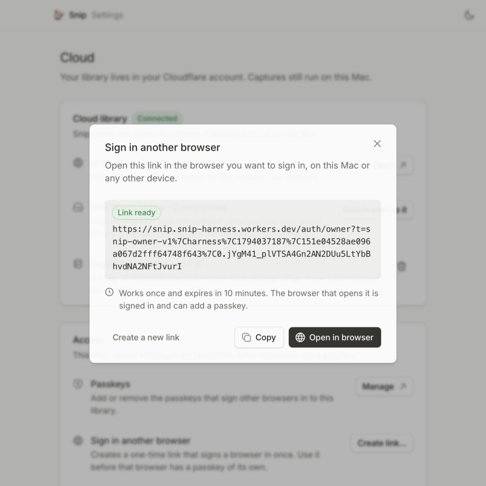
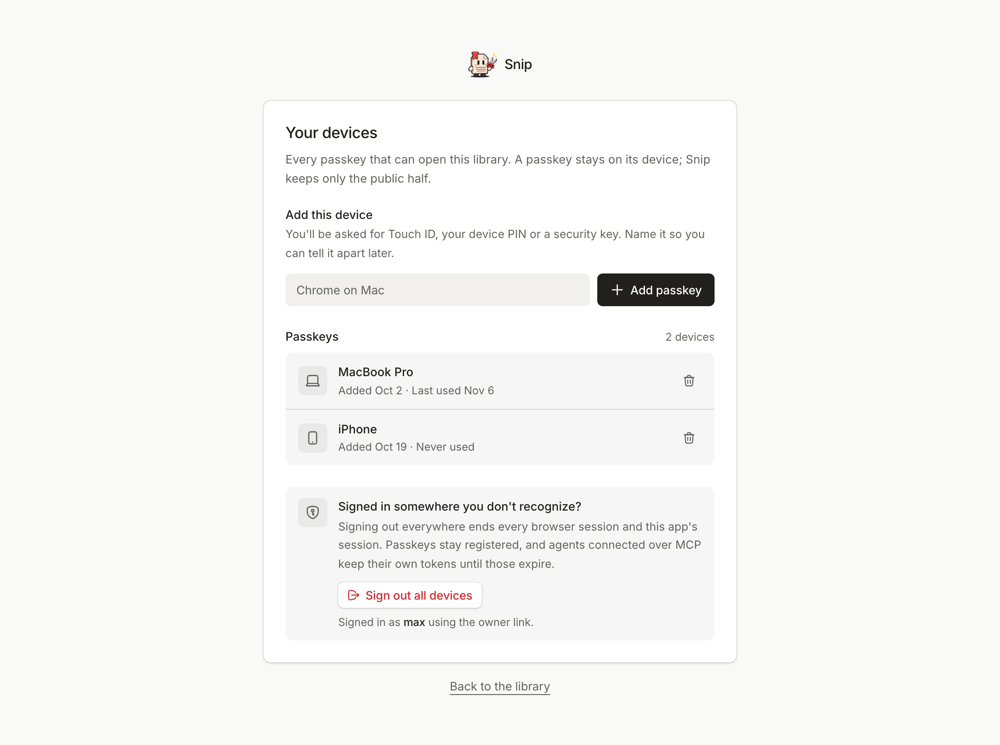
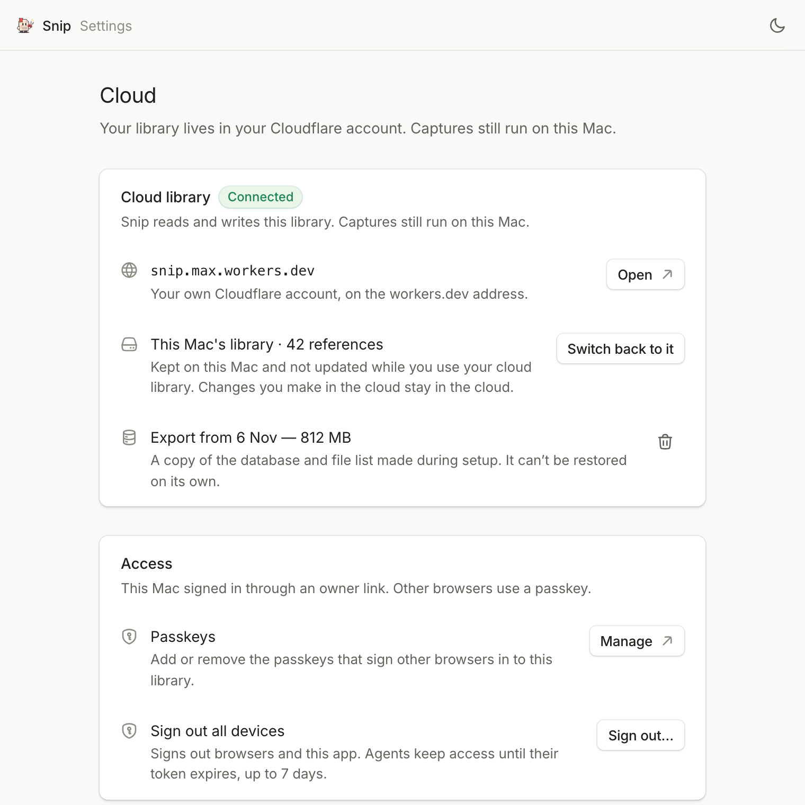
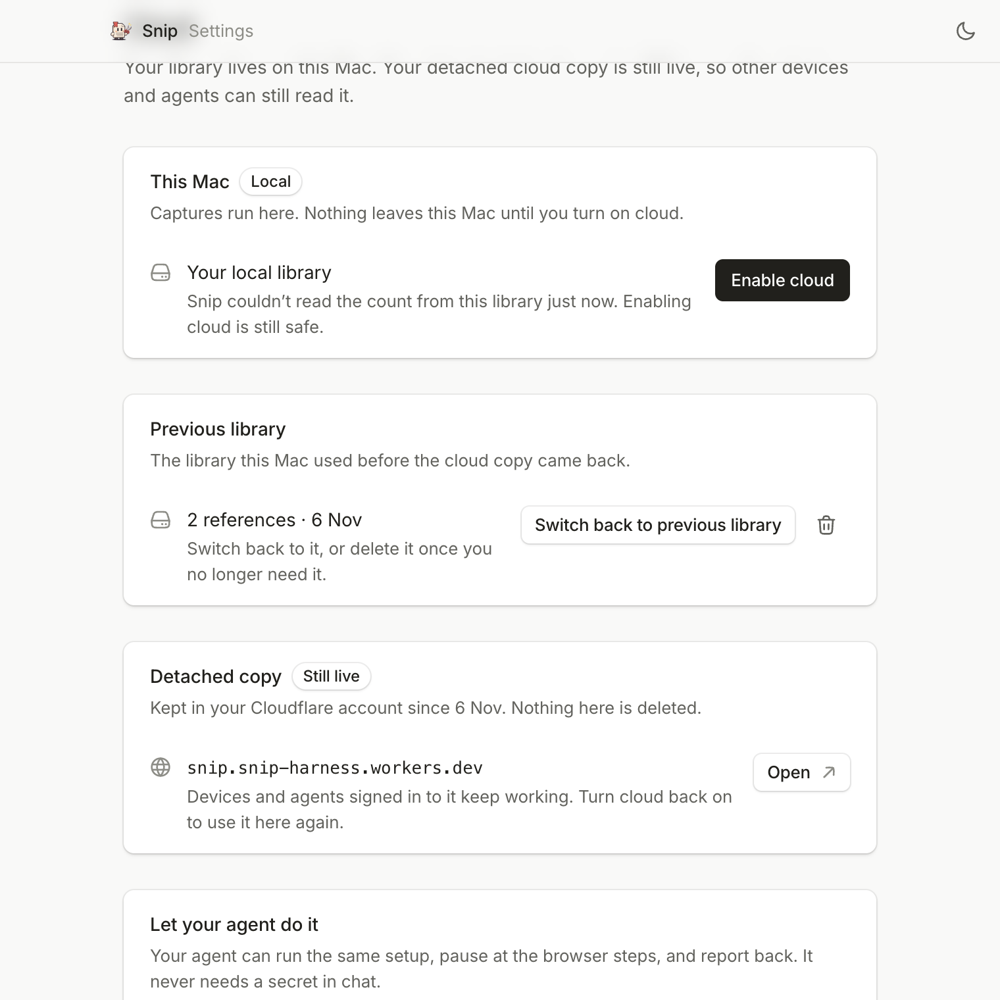
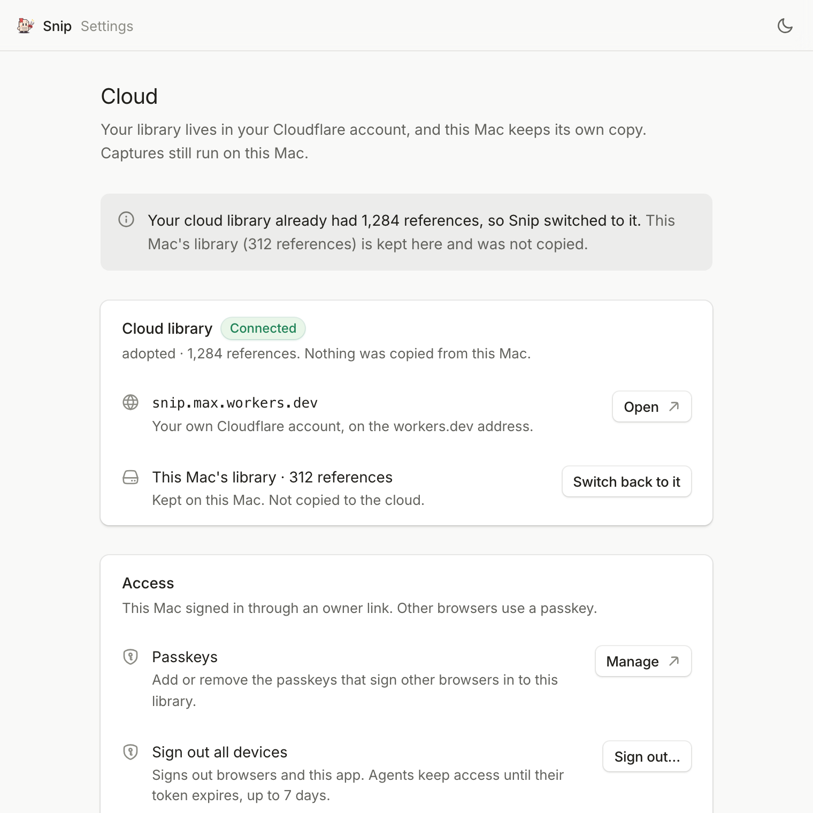

# Cloud mode: your library on your other devices

Snip runs on your Mac and needs no server. Cloud mode is the optional second placement: the same app, with the library copied into your own Cloudflare account, so another Mac, a browser or a cloud agent such as Claude.ai can read it. The account is yours; there is still no Snip server.

Capture stays on this Mac. Cloud mode changes who can reach the library, not where pages are captured. Back to the [README](../README.md).

The app's **Settings → Cloud → Enable cloud** button is the normal path; the command line runs the same engine for scripts and agents. Both are described below.

## Enable cloud

In Snip.app, open **Settings → Cloud → Enable cloud**. The app shows a sheet first: what copies to Cloudflare, what stays on this Mac, and what Cloudflare will ask for. Nothing leaves the Mac until you approve it.

### What the sheet says

- **Copies:** every reference, page, animation, collection, note, extracted token, screenshot, recording, HTML snapshot and style file in the library.
- **Stays:** the local library itself, exactly where it is. Settings lists it as **This Mac's library**, with one action, **Switch back to it**; the app never renames or deletes it.
- **Doesn't move:** browser sessions and MCP grants. Agents sign in again at the new address.
- **Capture:** stays on this Mac. The capture agent is pointed at the new address after the copy finishes.

An **empty library** takes the same path. There is nothing to copy, the data steps are skipped, no local row is recorded, and the sheet says so.

### The two Cloudflare approvals

Usually two, and only one if R2 is already on:

1. **Sign in and allow.** Your browser opens on Cloudflare. Sign in and choose **Allow**. If you belong to more than one account, pick the one that will own the library. Snip asks for the access needed to create this one install.
2. **Turn on R2.** If R2 has never been enabled on the account, Cloudflare asks for a card once, even though storage is free up to 10 GB. Snip opens the R2 page and waits; come back when it's on and the setup continues on its own.

There are no IDs to copy, no secrets to paste and no dashboard steps besides those. The rest runs in the app.

### The owner link and passkey

When the Worker is up, Snip opens a **one-time owner link** in your browser. It registers a passkey there (Touch ID on a Mac) and hands the signed-in session back to Snip.app, so the app arrives signed in without a second login.

- The link works once and expires after ten minutes.
- The link always signs in as the library's one owner. On a fresh install that identity is created; on a re-enabled or adopted library it is reused, so a second owner row never appears.
- The passkey is what you use to sign in to the cloud library from another browser or device. Registering one only adds a device: Snip never replaces or deletes an existing passkey, and adding the same device twice says **You already added a passkey on this device.**
- The app stores the secret that mints these links on this Mac. If it is ever lost, `owner rotate` sets a new one and mints a fresh link.

### Signing in later

At the cloud address, **/sign-in** is the everyday door: **Sign in with a passkey**, under **Use the passkey saved on this device. Nothing to type, nothing to remember.**

The page adapts to the device in front of it:

| What it finds | What it says |
| --- | --- |
| A passkey on this device | The sentence above, the note that Snip only ever sees the public half of the passkey, and **Sign in with a passkey**. |
| No passkey registered anywhere on the library | The button is replaced by **Reload once you've added one**, and the page explains: **This library has no passkey yet. Open Snip on the Mac that owns it and use the owner link under Settings → Cloud: it signs this browser in once, and you can add a passkey here.** |
| A passkey elsewhere, but not here | **No passkey on this device? Open Snip on the Mac that owns this library and use the owner link under Settings → Cloud.** |
| A legacy install that still has GitHub credentials | The footer becomes **No passkey on this device? Use GitHub if this library allows it, or add one from a signed-in device.** |

### Signing another browser in

That owner link is a row in Settings: **Settings → Cloud → Sign in another browser**, with the body **Creates a one-time link that signs a browser in once. Use it before that browser has a passkey of its own.**, and a **Create link…** button.



The sheet is titled **Sign in another browser**, and says **Open this link in the browser you want to sign in, on this Mac or any other device.** Once a link exists it carries a **Link ready** badge, never "signed in", because this Mac cannot see the other browser. Under it is the exact sentence:

> Works once and expires in 10 minutes. The browser that opens it is signed in and can add a passkey.

Three buttons: **Copy** (which becomes **Copied**), **Open in browser**, and **Create a new link**. A failed mint shows the error and offers **Try again** instead. Nothing is claimed about the other device until it opens the link and registers a passkey.

From a terminal, `owner link --no-handoff` mints the same link, which is the command that button runs.

**/passkeys** (also **Passkeys and devices** in the account menu) lists every passkey that can open the library:



- **Add this device** names the device and asks for Touch ID, your device PIN or a security key. The passkey stays on the device; Snip keeps only the public half.
- **Remove** retires one device, which is the recovery path for a lost laptop or phone. It also signs out every other browser and the app, and connected agents have to reconnect. If it was your only passkey, you sign in again with the owner link.
- **Sign out everywhere, including connected agents** ends every browser session, the app's session and every agent connected over MCP. Browsers and the app sign in again, agents reconnect, and the Mac's owner link is the way back in. Passkeys stay registered.

**Connecting a cloud MCP client.** The client sends the browser to `/authorize`, which redirects to `/sign-in?next=<the authorize URL>`. Sign in with a passkey and you land back on that same URL, query included, so the client's authorization request survives the detour and its approval screen appears. Approve there and the client is connected; the grant is bound to the owner identity, not to the method that signed in.

**One owner in this release.** The person who enabled cloud is the only person who can sign in, on their own devices. There is no invitation, no allowlist and no second account to set up; sharing a library with a second person is planned for later.

### While it copies

Snip creates the database, key-value store, bucket and Worker, applies the schema, deploys, copies the library and checks the result. The sheet shows one step at a time and keeps later steps dimmed.

- A capture that is running **pauses first** and continues on the cloud side after the move, instead of restarting from scratch.
- A failed step stays on screen with a **Retry** button. Retrying re-checks the steps that already passed, so it resumes rather than starting over.
- **Cancel** stops safely after the current action and leaves the install recorded as `enabling`, so running it again resumes. **Undo setup** is the separate action that returns this Mac to local and deletes only the resources this run created. Your local library is never changed by either.
- When it finishes, the window reloads on your cloud URL, Settings moves to the menu bar, and the capture agent serves the cloud library.

### Waiting for your Mac

Capture is not hosted. A capture started from another device, including one started by an agent, is queued in the cloud database and runs when this Mac's capture agent next checks in.

The gallery card and every agent status use the same words, **Waiting for your Mac**, whether the agent is busy or the Mac is asleep. Nothing captures while the Mac is off; the queue waits.

## Command line and agents

The Settings button and the command line run the same provisioning engine. Use the CLI when you are already in a terminal, when you are scripting a setup, or when an agent is doing the work. It never replaces a step a person has to do in Cloudflare.

```bash
npm run setup:cloudflare -- --check --json   # preflight only; changes nothing
npm run setup:cloudflare -- --yes --json     # enable cloud, never prompt
```

With `--json`, stdout carries one JSON object per line and human text goes to stderr. Each line is a `step`, `log`, `human`, `choice`, `needs_input`, `session` or `result`; the last is always `result`, and exit code 0 means success. A `human` event carries a URL the person must open (Cloudflare's allow page, the R2 page, the owner link); the run waits until they finish. A `choice` event describes a decision with consequences and exits 2 with `data.resumeWith`; `--yes` does not answer it. A `needs_input` event also exits 2 and names the missing flags. Never log the `session` line.

Exit 4 means this machine or this library cannot be provisioned right now. It covers every preflight refusal, each with its own `result.code`: `NOT_A_LIBRARY`, `NO_NODE`, `NO_WRANGLER`, `NO_BUILD`, `BAD_CONFIG`, `NOT_AN_ACCOUNT`, `LOCAL_SERVER_RUNNING`, `UNSUPPORTED_PLATFORM` and `FOREIGN_SNIP`.

**Every failed result carries `retryable`, not only exit 4.** Branch on that field instead of the code string. `true` means the same command can work: something outside Snip changes, or the failure was temporary. `false` means repeating it cannot help. Inside exit 4, `NOT_AN_ACCOUNT` and `LOCAL_SERVER_RUNNING` are the retryable ones and the other seven are final. A step failure says so for itself when it is worth repeating, for example an unreachable surface or a Cloudflare hiccup. A usage failure is always `retryable: false` with `code: "USAGE"` and the reason in `data.reason`: an unknown flag, a flag missing its value and an unknown command all report it, so an agent never has to guess what a missing field means.

A Cloudflare hiccup gets its own code. Setup retries a transient failure on `deploy`, `d1 migrations apply` and the secret writes, up to four attempts with growing waits, and only then gives up:

> Cloudflare had a temporary problem, try again.

That result is `code: "CLOUDFLARE_TEMPORARY"` and `retryable: true`, and its `data` carries the reason, the attempt count and the last output. Only operations that are safe to repeat are retried: a `d1 create` never is, because repeating it could leave an orphan. A rate limit, a `5xx`, a dropped connection or one of Cloudflare's known transient API codes is retried; an authentication or permission failure is not, because waiting never grants access. Run the same command again in a minute.

Cloudflare's `7403` is the one code that can mean two things: an edge hiccup that clears on its own, or a request made against the wrong account, which no retry fixes. Because it is reported only after the retries are spent, both readings are named:

> Cloudflare refused the request. Try again; if it keeps happening, check that you're signed in to the Cloudflare account that owns this Snip.

That result also carries `ambiguousAccount: true` in `data` and the hint **Run `npx wrangler whoami` to see which account you are signed in to; the database and bucket must be the ones this Snip was set up with.**

| Flag | Meaning |
| --- | --- |
| `--yes` | Never prompt. Missing values exit 2 instead of waiting for input. It suppresses questions, not consequences: it never adopts an existing library. |
| `--check` | Preflight only: report what is missing and exit. Safe to run first. |
| `--json` | One JSON event per line on stdout; nothing else. |
| `--resume` | Accepted, and resuming is what happens anyway: every step re-checks its own result, so rerunning `setup` continues an interrupted one instead of starting over. |
| `--account <id>` | Choose the Cloudflare account instead of the first membership. |
| `--domain <host>` | Override the public URL. workers.dev only in this release. |
| `--login <name>` | Record the sign-in name for this install. It fills the legacy GitHub allowlist in the generated config, which stays inert because a new install never provisions GitHub credentials. |
| `--capture-env <replace\|separate\|keep>` | Where the capture agent points afterwards. The app defaults to `replace`; the CLI defaults to `keep`. |
| `--adopt-existing` | Take **Use that library** when the account already holds a Snip library with data. Without it the run emits a `choice` and exits 2. Required in any unattended run that should adopt. |
| `--managed` | The app's own mode: it replaces the capture environment and can use its loopback handoff. Not needed from a terminal. |
| `--no-open` | Print URLs instead of opening a browser. |
| `--no-handoff` | With `owner link`: mint the link for another browser or device. It carries port 0, no handoff is attempted, and the command ends as soon as the link is minted. `setup` always uses the handoff. |
| `--root <path>` / `--data-root <path>` | Run against a different checkout or library. `--root` also sets `--data-root` when the latter is absent, and either works before the command: `--root <path> status` reads that install's record. |
| `--confirm <name>` | The interlock the destructive commands check. See [Other commands](#other-commands). |

Exit codes: `0` success, `1` failed, `2` missing input or an unanswered choice, `3` another run holds the lock, `4` this machine or library cannot be provisioned right now (see the `result.code` list above).

The CLI leaves `capture/.env` alone by default and writes the cloud settings to `capture/.env.cloud`. Run the agent against the hosted copy with:

```bash
SNIP_CAPTURE_ENV_FILE=capture/.env.cloud npm run capture
```

Pass `--capture-env replace` to point `capture/.env` at the cloud copy, or use the app's button, which does that for you.

### Other commands

`npm run setup:cloudflare` runs `setup` when no command is given. Add a command after `--` for everything else:

| Command | Does |
| --- | --- |
| `npm run setup:cloudflare -- status --json` | Print the saved install: mode, URL, account, snapshot, last error. Reads `cloud.json` only, so it works offline and takes no lock. |
| `npm run setup:cloudflare -- status --check --json` | The one form that uses the network: ask the local and cloud origins whether they answer, and name which surface answered. |
| `npm run setup:cloudflare -- detach --json` | Turn off cloud on this Mac. No Cloudflare calls. |
| `npm run setup:cloudflare -- pull --json` | Copy the cloud library back to a new local library, verify it and switch. What was here becomes the **Previous library**. |
| `npm run setup:cloudflare -- snapshot restore --json` | Switch back to the **Previous library** left by a `pull`. Refuses when this Mac's own library never moved. |
| `npm run setup:cloudflare -- snapshot delete --confirm <basename>` | Delete the **Previous library**. Destructive. |
| `npm run setup:cloudflare -- snapshot delete-export --confirm <basename>` | Delete setup's portable dump and file list. It cannot restore anything on its own. |
| `npm run setup:cloudflare -- delete-resources --confirm <host>` | Delete the Worker, D1, KV and R2 for this install. Destructive. Refused while this Mac is using the cloud library: `pull` or `detach` first. |
| `npm run setup:cloudflare -- owner link` | Mint and open a fresh one-time sign-in link for this Mac. |
| `npm run setup:cloudflare -- owner link --no-handoff` | Mint a link for another browser or device and print it. Settings' **Sign in another browser** runs exactly this. |
| `npm run setup:cloudflare -- owner rotate` | Replace the owner-link secret and mint a new link. Recovery path. |
| `npm run setup:cloudflare -- abort` | Clean up an interrupted enable. |
| `npm run setup:cloudflare -- migrate --json` / `deploy --json` | Apply remote migrations or deploy the current build. Used by updates. |

The three destructive commands share one interlock. `--confirm` must equal the basename of the item being deleted: the directory name for `snapshot delete` and `snapshot delete-export`, and the cloud URL's host (for example `snip.max.workers.dev`) for `delete-resources`. Leave it out and the run exits 2 with the exact command to repeat; give a different value and it exits 1. Neither path changes anything. The app asks for the same value, typed by hand.

### Signing another device in from the CLI

`owner link` opens the link on this Mac and, when the app is driving, waits for the browser to hand the session back. That is wrong for a device that is not this Mac, so pass `--no-handoff`:

```bash
npm run setup:cloudflare -- owner link --no-handoff
```

It mints the link, prints it in a `human` event and in the step result, and stops. Nothing is opened, no handoff is attempted, and no `session` event is emitted, because this Mac has no session to receive. Open the printed link on the other device within ten minutes and register a passkey there. This is the same command Settings runs when you press **Sign in another browser**.

## Turning cloud off

**Settings → Cloud → Turn off cloud** detaches this Mac. It does not delete the cloud copy. In Settings the panel is **Leave the cloud copy where it is and go back to this Mac. Nothing is deleted.**, with the row **Use this Mac's library again** and the note that the cloud library stays reachable for other devices and agents.

The dialog asks first and says exactly what stays:

> **Turn off cloud?**
> Changes made in your cloud library stay there. This Mac goes back to its library from 6 Nov, 10:12 (812 MB). Your cloud library is still reachable at snip.max.workers.dev, and devices and agents signed in to it keep working.

The date and size come from this Mac's own row. For a library that started empty there is no row, and the second sentence is **This Mac goes back to an empty library**.

The dialog offers three outcomes:

- **Stay in cloud** — "Keep using the cloud library. Nothing changes." The default; the confirm button stays disabled.
- **Turn off and keep local** — "This Mac goes back to its own library. Nothing is deleted, on this Mac or on Cloudflare." Detach happens now, and the cloud copy stays live.
- **Bring the cloud library back to this Mac** — "Downloads the cloud library, checks every reference, then switches this Mac to it. This Mac's current library is kept." Marked **Recommended if you made changes**, with **Copy prompt for your agent** beside it. The confirm button becomes **Copy back now**.

Nothing is copied back automatically. If you worked in the cloud copy and want those changes here, use **Copy back now** or `pull`.

### Copy back

**Copy back now** (or `npm run setup:cloudflare -- pull --json`) downloads a manifest, exports the cloud database, stages a **new** local library, downloads every file, checks counts and a digest, and only then swaps it in. The library this Mac used before the pull is kept as **Previous library**, so a pull leaves one live library plus one restorable copy.

When it finishes, this Mac is in local mode. The cloud copy still exists and is still reachable; detaching and copying back are separate from deleting.

### What Settings lists

Two kinds of local copy exist, and only one of them can be restored. **Settings → Cloud** shows whichever this Mac has:



| Row | When it appears | Actions |
| --- | --- | --- |
| **This Mac's library · 312 references** | The library never moved: after enabling cloud, and after adopting an existing one. Subtitle: **Kept on this Mac and not updated while you use your cloud library. Changes you make in the cloud stay in the cloud.** | **Switch back to it** only |
| **Previous library · 312 references** | Only after **Copy back now** or `pull` replaced this Mac's library. Subtitle: **Snapshot from 6 Nov, 10:12 — 812 MB. This Mac used it before the copy came back.** | **Switch back to previous library**, or delete it |
| **Export from 6 Nov — 812 MB** | After setup exported a library that had data. Subtitle: **A copy of the database and file list made during setup. It can't be restored on its own.** | Delete only |

Enabling cloud never moves the local library, so after a move there is no Restore and no delete on **This Mac's library**: it is still the live library, and **Switch back to it** is the way back. The CLI refuses both commands rather than guessing, with **Your library is still on this Mac, so there is nothing to restore.** for `snapshot restore` and **This Mac's own library is not a snapshot, so it cannot be deleted.** for `snapshot delete`.

A real second copy appears only when `pull` swaps the cloud library in. That is what **Previous library** is: a complete library that can be swapped back, counted by reading it rather than assumed. If the count cannot be read, the pull puts the original back and fails instead of recording something untrue.



**Export** is insurance, not a restore point. It is the database dump and file list setup wrote before the copy, and it cannot rebuild the stored files, so it has no restore action at all. `snapshot delete-export --confirm <basename>` and the trash button on that row delete only the dump; the live library and the previous library are untouched. An install that still has a record written by an older version, where the dump was recorded without a kind, is refused by `snapshot restore` with **These are this Mac's backup files, not a library that can be swapped in.** and a pointer to `delete-export`.

### Delete cloud resources

Deleting the cloud copy is separate, destructive and never offered inside the turn-off dialog. **Settings → Cloud → Delete cloud resources** removes the Worker, D1 database, KV namespace and R2 bucket after you type the library's address.

The local library and any previous library on this Mac are not touched. Deleting cannot be undone; the next enable starts a new install and copies the local library up again.

### Sign out everywhere

**/passkeys → Sign out everywhere, including connected agents** (also in Settings → Cloud) ends every browser session, the app's session and every connected agent's access for this install. Use it if a laptop, browser or agent with access is lost.

The page says exactly what it does: browsers and the app have to sign in again, agents connected over MCP have to reconnect, and the Mac's owner link is the way back in. One counter decides whether a browser session or an agent's grant is still valid, so there is no way to disconnect a single agent. Passkeys stay registered. A passkey is a credential, not a session, so removing one from the list is a separate action, and signing out never removes devices.

## One Snip per Cloudflare account

Snip keeps one library per Cloudflare account. Before changing anything, setup looks at what is already there and takes one of five paths:

| What it finds | What happens |
| --- | --- |
| Nothing | Normal setup. |
| This Mac's own interrupted install | Resumes it, re-checking the steps that already passed. |
| An **empty** Snip from an older install | Adopts it silently, redeploys over it, and continues. Nothing is asked, because there is nothing to lose. |
| A Snip from an older install **with data** | Asks. Nothing has changed yet. |
| Another Worker named `snip` that is not a Snip | Refuses before touching anything. |

### Adopting a library you already had

If you deployed Snip before the Settings button existed, the account has a Worker, database and bucket but no record on this Mac that they are yours. Because it can tell a Snip from anything else by its schema, bindings and deploy config, Snip recognises that install. An empty one is simply adopted.

One **with references** needs a decision:

> This Cloudflare account already has a Snip library.
> **Use that library** — Switches this Mac to it. Your local library is kept and is not copied.
> **Stop** — Changes nothing.

- **Use that library** adopts the existing URL, account, database, KV namespace and bucket. Your local library stays exactly where it is, untouched: it is not moved, renamed or copied, because nothing needs to be duplicated for ceremony. The status line reads **adopted · 1,284 references**, never "verified", because no copy was verified. Existing passkeys and browser sessions keep working, and `CAPTURE_TOKEN` is regenerated for this Mac's capture agent.
- **Stop** leaves the account and this Mac exactly as they were.
- From the CLI, use `npm run setup:cloudflare -- --adopt-existing --json`. The choice event exits 2 with `data.resumeWith` set to that flag. **`--yes` alone never adopts**: it suppresses questions, not consequences, so an unattended run that should adopt must pass `--adopt-existing` explicitly. Leaving it out is not an error, it is the safe default.

After adoption, Settings states both halves, because you need to know where each library is:

> Your cloud library already had 1,284 references, so Snip switched to it. **This Mac's library (312 references) is kept here and was not copied.**

The panel above it reads **adopted · 1,284 references. Nothing was copied from this Mac.** and never claims the copy was verified, because it wasn't.

The local library is listed as **This Mac's library · 312 references**, with the subtitle **Kept on this Mac. Not copied to the cloud.** It has exactly one action, **Switch back to it**, which detaches this Mac and returns to the local library. It is not a snapshot: there is no copy to restore, so it offers no Restore and no Delete, and Snip never offers to delete your only local library from a status row. Before it runs, the turn-off dialog says what stays: **Changes made in your cloud library stay there. This Mac goes back to its library from 6 Nov, 10:12 (812 MB).**



The owner link on an adopted library signs in as the **same owner** and adds this device's passkey. It never replaces or deletes a passkey that was already there, so a re-enabled install keeps every device it had. Adding a device that already has a passkey shows **You already added a passkey on this device.**

### When the account has something else

A Worker named `snip` that does not look like Snip is refused, before anything is created:

> This account has a Worker called `snip` that is not a Snip library. Snip keeps one library per account; rename or delete it, or choose another account.

That refusal is exit 4 with `code: "FOREIGN_SNIP"` and `retryable: false`: repeating the command cannot help. Rename or delete the Worker in the Cloudflare dashboard, or choose another account.

There is no replace option and no second Worker name. The name is the address your passkey and agent connections are bound to, so it cannot vary per install.

## workers.dev only

Cloud mode uses the Worker name `snip` on your account's workers.dev subdomain, for example `https://snip.max.workers.dev`. Custom domains are not supported in this release: they would change the address that passkeys and MCP connections are bound to. Use the URL Snip prints everywhere you connect a client.

## One owner in this release

Cloud mode has exactly one owner: the person who enabled it. They sign in with a passkey on each device they use, and so does an agent they connect to the cloud address. Nothing in setup asks for GitHub, there is no OAuth app to register, no Client ID and no client secret to paste, and no allowlist to keep up to date.

Sharing a library with a second person is planned for later. When it ships, it will not change how you sign in today.

**Installs that already configured GitHub keep working.** An install set up by an earlier version that has `GITHUB_CLIENT_ID` and `GITHUB_CLIENT_SECRET` set on its Worker still mounts GitHub sign-in, still honours its existing allowlist, and still offers **Use GitHub** on the sign-in page. Setup leaves those secrets alone. That path lives on the Worker's **/sign-in** page only: Settings is a passkeys-only surface for every install, so it never mentions GitHub and a legacy owner manages devices there exactly like a new one. A fresh install never provisions the credentials.

## Updating a cloud install

`npm run update` updates both halves when this Mac is in cloud mode: it fast-forwards, rebuilds, applies the remote database migrations, deploys the new Worker and then restarts capture. Existing captures and saved files are kept.

A release build does the same on its first launch after a version change, before the window loads. If that deploy fails, Snip shows it as a blocking step instead of running a new app against an old Worker.

Snip records the Worker version it deployed. If the deployed Worker no longer matches that record, Snip reports the deployment as changed outside Snip and asks you to deploy again; it does not redeploy on its own, because someone may have changed the Worker deliberately.

To do it by hand, apply migrations before deploying:

```bash
npm run setup:cloudflare -- migrate --json
npm run setup:cloudflare -- deploy --json
```

## If the cloud library can't be reached

If the Worker is deleted in the Cloudflare dashboard, the account changes, or the URL stops resolving, Snip says **This Mac's cloud library can't be reached** and offers this Mac's own library or a new enable. It does not quietly open the empty local library instead.

## Debugging a setup

The supported ways to turn on cloud mode are **Settings → Cloud** and the CLI. Both run the same engine, which records the install in `.snip/cloud.json`; only the engine writes there. A Worker deployed by hand is not adopted by Snip.app, because the app would have no record of owning it.

When a setup stops:

```bash
npm run setup:cloudflare -- status --json          # mode, URL, account, snapshot, last error; offline
npm run setup:cloudflare -- status --check --json  # the same, plus whether the origins answer
npm run setup:cloudflare -- --check --json         # preflight: what is missing, without changing anything
npm run setup:cloudflare -- setup --resume --json   # resume; completed steps re-verify and skip
npm run doctor                                     # offline checkout and capture checks
```

`status` reads `cloud.json` and nothing else: no Cloudflare call, no Worker, no lock, so it works offline and for an agent that only needs to know the mode. `--check` is the one form that goes to the network, and then it says which surface answered.

`npm run doctor` is offline by default too. It checks Node, dependencies, both config files, the capture browser and the capture token against the local Worker, and prints one line per problem with the command that fixes it. Cloud checks are read from `cloud.json` alone and are reported only when this Mac is in **cloud** or **enabling** mode, so a local-only library never sees a cloud warning. Add `--check` to let the doctor probe the cloud library as well, and `--data-root <path>` to read another install's record:

```bash
npm run doctor -- --check
npm run doctor -- --data-root /path/to/another/library
```

- `.snip/cloud.json` holds `mode`, the cloud record and the per-step journal, including `error` with the failing step and a hint. It is safe to read; do not edit it.
- A partial install stays at `mode: "enabling"`, so the next run resumes instead of starting over. `abort` is the only command that returns an interrupted enable to local.
- The built Worker, its client assets and the migrations are copied into `<library>/cloud/` on every deploy. That directory is disposable; the next deploy overwrites it from the build. `web/wrangler.deploy.jsonc` is not written by setup any more; it is read only to recognise an install made by an older version.
- Nothing is ever written inside Snip.app's bundle, so a failed deploy cannot corrupt a release build.

If the Worker is healthy but the app shows the wrong library, check `status` before touching anything: `mode` decides whether the window opens this Mac's library or the cloud URL, and editing Cloudflare resources by hand does not change it.

## Free-tier headroom

R2 gives 10 GB (roughly 3,000 to 6,000 captured pages, depending on page length and motion), D1 5 GB, Workers 100k requests a day. The account menu shows how much of the R2 free tier a hosted Snip is using; the local app shows the bytes stored on this Mac instead.

The hosted Worker rate-limits sign-in and MCP connection setup so repeated requests stay cheap; the storage meter is cached for five minutes. See [Cloudflare cost controls](cloudflare-cost-controls.md) for the limits, billing alerts and an optional CPU ceiling on Workers Paid, and [storage usage](storage-usage.md) for how the meter is counted.
